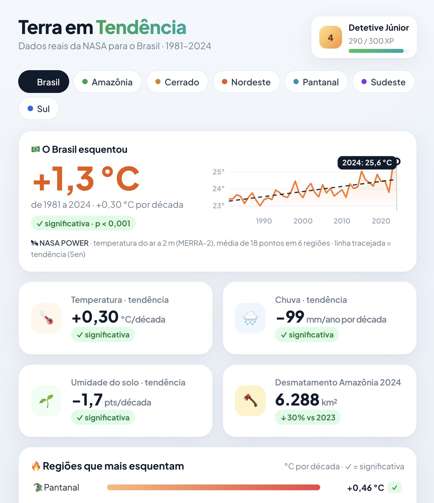

<div align="center">

# 🌎 E.V.A · Pergunte ao planeta

**Dados de satélite da NASA, estatística de verdade e explicações simples para estudantes do ensino médio.**

[](#-status)
[](https://www.earthdata.nasa.gov/)
[](#-landing-page)

[Landing page](https://lucas-vicenzzo.github.io/time-eva/) · [Drive do projeto](https://drive.google.com/drive/u/2/folders/1assPWxWg7m0SatUudmoIxkNvh6jZY6Td) · [Como funciona](#-como-funciona)



</div>

---

## 📌 Sobre

O **E.V.A** é uma plataforma educacional que torna os dados de satélite da NASA acessíveis a adolescentes.

O aluno faz uma pergunta ou escolhe um lugar no globo. O sistema seleciona as variáveis relevantes, gera a série temporal da região e responde **o que está mudando, onde, quanto e se a mudança é estatisticamente significativa ou só acaso**. Uma IA explica o resultado em linguagem simples, mas **nunca calcula**: os números vêm de código e são conferidos por um verificador.

## ❓ O problema

Os dados climáticos são públicos, mas difíceis de encontrar e de interpretar. Estão espalhados em portais técnicos, formatos científicos e unidades pouco intuitivas. Isso afasta os estudantes do ensino médio da evidência real das mudanças no planeta e limita a conscientização.

- **Difícil de encontrar:** dezenas de portais, produtos e versões.
- **Difícil de interpretar:** uma linha que sobe pode ser tendência ou ruído.
- **IA que inventa:** chatbots respondem com confiança números que não existem.
- **Escola sem estrutura:** muitas escolas públicas não têm laboratório nem permitem celular em sala.

## ⚙️ Como funciona

```
 Pergunta / lugar no globo
          │
          ▼
 ┌──────────────────┐   ┌──────────────────┐   ┌──────────────────┐   ┌──────────────────┐
 │ 1. Coleta        │──▶│ 2. Estatística   │──▶│ 3. Explicação    │──▶│ 4. Verificação   │
 │ código           │   │ código           │   │ IA               │   │ verificador      │
 │ série da região  │   │ Mann-Kendall,    │   │ linguagem        │   │ cada número do   │
 │ nos produtos     │   │ Sen, IC 95%      │   │ simples, sem     │   │ texto é comparado│
 │ NASA             │   │                  │   │ gerar números    │   │ com o código     │
 └──────────────────┘   └──────────────────┘   └──────────────────┘   └──────────────────┘
          │
          ▼
 O que muda · onde · quanto · se é real
```

**Quando não há dado, o planeta diz "sem dado"** em vez de inventar uma resposta.

### Métodos estatísticos

| Método | Para que serve |
|---|---|
| **Mann-Kendall** | Testa se existe tendência monotônica ou se a variação é acaso. Não exige distribuição normal. |
| **Inclinação de Sen** | Estima quanto a variável muda por década, de forma robusta a valores extremos. |
| **Intervalos de confiança** | Mostram a margem de incerteza de cada tendência. |

### Fontes de dados

| Fonte | Tipo | Variáveis |
|---|---|---|
| [MODIS](https://modis.gsfc.nasa.gov/) (Terra/Aqua) | Satélite | Vegetação (NDVI/EVI), queimadas |
| [GPM · IMERG](https://gpm.nasa.gov/data/imerg) | Satélite | Precipitação |
| [OMI](https://aura.gsfc.nasa.gov/omi.html) (Aura) | Satélite | NO₂, ozônio, poluição |
| [MERRA-2](https://gmao.gsfc.nasa.gov/reanalysis/MERRA-2/) | Reanálise | Temperatura a 2 m, umidade |
| [NASA POWER](https://power.larc.nasa.gov/) | Serviço | Séries por ponto geográfico |
| [NASA Earthdata](https://www.earthdata.nasa.gov/) | Portal | Origem dos dados do protótipo |

Os dados oficiais utilizados estão no [Drive do projeto](https://drive.google.com/drive/u/2/folders/1assPWxWg7m0SatUudmoIxkNvh6jZY6Td).

## 🌋 Mexa no Planeta

Um sandbox para manter o interesse: o aluno dispara "lasers" (a erupção de um vulcão, o desmatamento de uma floresta, o desligamento de uma cidade) e vê o que os dados reais mostraram quando algo parecido aconteceu de verdade, inclusive efeitos opostos em regiões diferentes.

## 🏫 Em sala de aula

- **Modo individual:** o estudante explora no próprio ritmo, com níveis de "detetive" e XP.
- **Modo sala de aula:** o professor projeta o globo, a turma aposta e investiga junto.
- **Sem celular:** cartões de votação permitem que todos participem só com o projetor.

## 🎯 Público-alvo

| Perfil | Quem é |
|---|---|
| **Quem usa** | Estudantes do ensino médio (14 a 18 anos) |
| **Quem aplica** | Professores de Ciências da Natureza, Geografia, Matemática e tecnologia |
| **Quem decide** | Gestores escolares, redes de ensino e secretarias de educação |

## ✅ Validação

> "É importante trazer a NASA, que é algo muito distante, para perto dos alunos."
>
> — **Sandra Miranda**, diretora da Escola Prof. Paulina Gaya

> "Poder investigar um fenômeno real, escolher um lugar do planeta, levantar hipóteses e confrontá-las com dados científicos pode ser muito envolvente para os adolescentes."
>
> — **Milena**, gestora da Happy Balneário Camboriú

A gestora também confirmou o problema ("não temos hoje um caminho estruturado para localizar, interpretar e transformar esses dados em atividades pedagógicas") e demonstrou interesse em um piloto com uma turma.

## 🚧 Status

O E.V.A é hoje um **protótipo**, com dados extraídos do portal NASA Earthdata. O painel atual mostra 44 anos de dados (1981–2024) para o Brasil e seis biomas e regiões.

- [x] Protótipo com dados reais e testes estatísticos
- [x] Validação com gestoras de escolas pública e privada
- [x] Landing page bilíngue
- [ ] Vídeo demonstrativo
- [ ] Piloto em sala de aula

## 💻 Landing page

A landing page é um site estático (HTML, CSS e JavaScript puro, sem build).

```
.
├── index.html     # página completa (estilos e scripts inline)
├── i18n.js        # traduções PT ⇄ EN
├── assets/        # imagens (protótipo, entrevistas, fotos)
└── docs/          # PDFs disponíveis para download
```

### Rodar localmente

```bash
python -m http.server 5510
```

Depois abra `http://localhost:5510`. Abrir o `index.html` direto no navegador também funciona, mas o globo 3D precisa de internet, porque carrega a biblioteca [globe.gl](https://globe.gl/) e a textura da Terra por CDN.

### O que editar

Todos os pontos pendentes estão marcados com `EDITAR` no `index.html`:

| O quê | Onde |
|---|---|
| Vídeo do YouTube | Cole o link em `data-youtube=""` no elemento `#video` |
| Documentos para baixar | Coloque em `docs/` como `apresentacao-eva.pdf`, `modelo-de-negocio-eva.pdf` e `documento-projeto-eva.pdf` |
| Fotos dos autores | `assets/autor-1.jpg` a `assets/autor-4.jpg` (quadradas) |
| Nomes e funções dos autores | Seção `EQUIPE` |
| E-mail de contato | Rodapé |

> Ao mudar um texto em português no `index.html`, atualize a mesma frase em `i18n.js`. Ela é a chave da tradução; sem isso, o trecho continua em português no modo inglês.

### Publicar com GitHub Pages

Em **Settings → Pages**, escolha **Deploy from a branch**, branch `main`, pasta `/ (root)`. A página fica disponível em `https://lucas-vicenzzo.github.io/time-eva/`.

## 👥 Equipe

| | Nome | Função |
|---|---|---|
| 1 | _a preencher_ | _a preencher_ |
| 2 | _a preencher_ | _a preencher_ |
| 3 | _a preencher_ | _a preencher_ |
| 4 | _a preencher_ | _a preencher_ |

---

<sub>Dados fornecidos pela NASA. O E.V.A não é afiliado nem endossado pela NASA.</sub>
